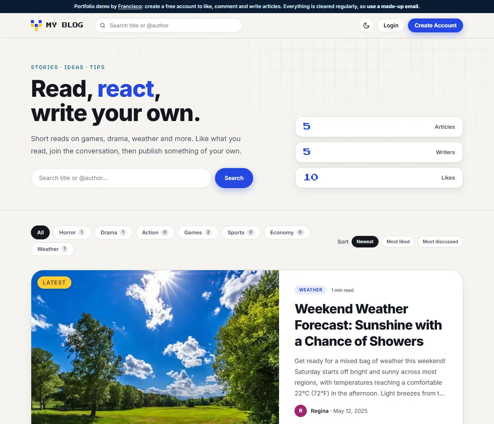
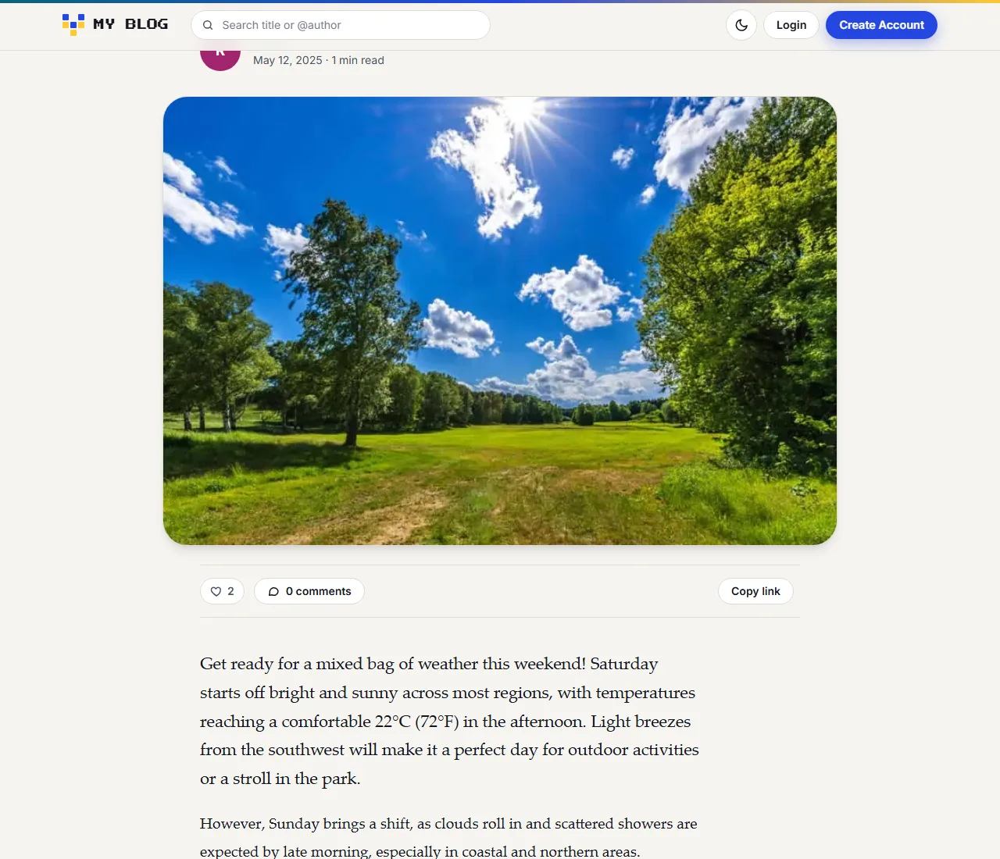
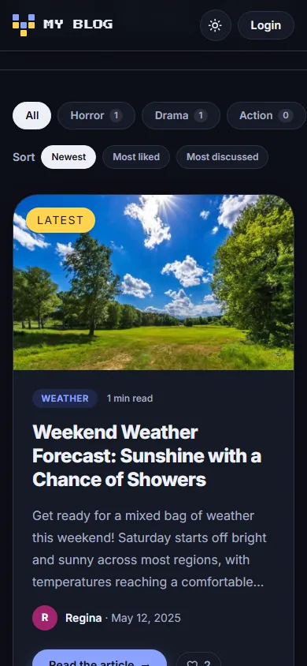

# My Blog: articles, likes and comments

A modern blog with pixel-art touches: signed-in users write articles with a picture, and everyone can search, filter by category, sort, like and comment. Light and dark themes, a reading-friendly article page, and a layout that works from a 320 px phone to a wide desktop.

Built with **Laravel 12, Blade, Tailwind CSS** and SQLite.

**Live demo:** https://blogapp.franciscowebdev.com (create a free account with a made-up e-mail to write, like and comment)

| Home | Article | Dark, on a phone |
| --- | --- | --- |
|  |  |  |

## What it does

- **Articles** with a title, category, body and optional picture. Pictures are shrunk to at most 1000 px and saved as WebP, with a 600 px copy for the list so phones download less. A blank line in the text starts a new paragraph; the form shows a live word count and a preview of the picture.
- **A home page that has something to say**: the newest article as a big card, a "Trending now" strip (the most liked), categories with their article counts, and a grid of cards with a short teaser, author, date, reading time, likes and comments.
- **Search, filter and sort**: by title, by `@author` or by category, and by newest, most liked or most discussed; articles with more than 10 likes get a "Popular" badge.
- **A comfortable article page**: large title, author line, reading time, a reading-progress bar, like / comment / copy-link / share bar, a serif reading column, comments with avatars and "Keep reading" suggestions (same category first). Link previews use the article's own title, teaser and picture.
- **Likes and comments** for signed-in users (one like per person; the heart shows when you have liked something).
- **Light and dark themes** that follow the device and can be switched by hand; the choice is remembered in the browser and applied before the page paints, so there is no flash.
- **Accounts**: register, log in, edit your profile, delete your account. Only the author can edit or delete an article.
- **Accessible and fast**: keyboard friendly with visible focus, a skip link, one `main` landmark per page, proper headings and labels, the automated accessibility check (axe) finds nothing on any page in either theme, motion is reduced for people who ask for it, and the page works without JavaScript (the scripts only add comfort).

## Run it locally

```bash
composer install
cp .env.example .env
php artisan key:generate
touch database/database.sqlite
php artisan migrate --seed
php artisan storage:link
npm install
npm run dev        # or npm run build
php artisan serve
```

`php artisan articles:thumbs` makes the small 600 px copy of any article picture that does not have one yet (useful after upgrading an older install).

## How it is built

- `app/Http/Controllers/ArticleController.php` builds the home page (filters, order, the featured and trending articles, category counts) and the article page (related articles, whether you liked it).
- `app/Models/Article.php` has the reading time, the teaser, the paragraphs and the `orderedBy()` scope behind the sort links.
- `resources/css/app.css` holds the whole look: colours are CSS variables, so the dark theme is one attribute on `<html>`.
- `resources/views/components/` has the building blocks (`article-card`, `featured-card`, `like-button`, `avatar`, `pager`, `owner-actions`) and `resources/js/app.js` the small helpers (theme switch, reading progress, copy / share, word count, picture preview).

## Tests

```bash
php artisan test
./vendor/bin/pint --test   # code style
```

The tests use an in-memory database and a fake `public` disk, so they never touch the real pictures in `storage/app/public`. GitHub Actions runs them, the code style check and the front-end build on every push.

## The portfolio demo

On the live demo `DEMO_MODE=true` is set. It shows a notice bar, puts the starting articles back as they were about once an hour (visitor accounts, their articles, likes and comments are removed after a few hours) and asks search engines not to index the demo (`X-Robots-Tag: noindex`). With the setting off it is a normal blog.

Part of the portfolio at https://franciscowebdev.com.
